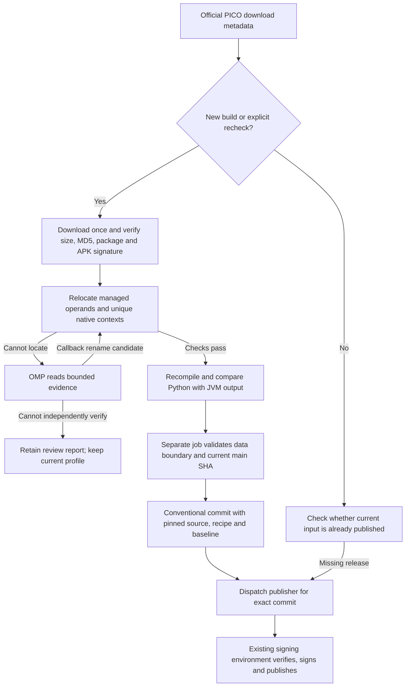

# Continuous VD profile adaptation

`Adapt new VD builds` checks the official download metadata every six hours. An unchanged build only runs the metadata job; it does not download an APK, compile Android code or call a model. New builds run on disposable GitHub-hosted runners. The current profile remains available throughout analysis.

## Flow



The automatic path updates input hashes, version metadata, the actual APK signer, signer-derived constants, loader digest/size and checked operand locations. It preserves the package strategy, loader routing, declaring types and entry points, expected call sites and patch counts. The APK signature must be valid and the startup certificate literal must match its actual signer; the historic publisher certificate is not pinned. The compiler retains its original-byte and structural checks. The JVM differential checks cover every assembly and the routed loader/native library against the Python reference, without requiring a fixed assembly count.

The baseline records five scoped managed methods and 22 instructions around each native comparison. A compiler-numbered identity callback is renamed automatically when the declaring type has exactly one candidate. For supported ARM64 Mono AOT layouts, the locator resolves each managed method token through the AOT call table and searches inside that method. It handles different registers and instruction spacing. When the table format is unavailable, it uses exact or distinguishable similar instruction contexts. A changed DEX, resource, assembly count, loader bytes or managed fingerprint alone does not stop adaptation. A missing method, unsupported loader routing or unresolved native location still requires review. These checks do not prove whole-program equivalence.

## Agent

The runtime is OMP `18.1.17` with `mikumiku-openai/glm-5.3-flash` using the configured OpenAI-compatible endpoint. Deterministic relocation makes no model call, including a unique callback rename. If relocation fails, the agent may select managed methods and native comparisons from bounded evidence extracted from the APK. Each selected location is independently rediscovered in that APK, then compiled and subjected to the same Python/JVM differential checks. Missing, invented or overlapping locations cannot be published. The differential checks prove consistent patch construction, not whole-program semantic equivalence.

OMP runs with an isolated home, no sessions, rules, skills, LSP, PTY or built-in tools. Its explicit extension provides only `read_evidence` and `submit_candidate`. It has at most 12 tool executions, 4,096 output tokens per response and a 180-second agent budget (210-second process cutoff). It receives no PICO session, GitHub write token or signing variables. Its raw traces are discarded. Only a bounded structured report is retained.

## Credentials

The `vd-adaptation` GitHub environment is restricted to the `main` branch:

- `PICO_AUTH_JSON`: SDK session for an account that owns VD. CI does not purchase anything. Session expiry stops acquisition and requires renewed sign-in.
- `MIKUMIKU_API_KEY`: provider key from the maintainer's OMP configuration.

Use `scripts/adaptation/configure_secrets.py` locally to copy the native SDK session and the configured OMP key directly into GitHub environment secrets, without printing their values. The model key is not provided to the cheap metadata job. The existing `profile-publishing` environment retains the signing key; neither analysis nor promotion receives it. The analysis jobs have no repository write permission. Promotion accepts only the known JSON artifact names, checks their digests/invariants and rejects a changed main branch. It never runs model-generated code.

## Manual operation

```sh
# Cheap observation; no commit or release.
gh workflow run adapt-vd.yml -f dry_run=true

# Full current-build rehearsal, including a real model tool loop; no release.
gh workflow run adapt-vd.yml -f dry_run=true -f recheck_current=true -f force_agent=true

# Retry acquisition/analysis and enable publication after trusted fixes.
gh workflow run adapt-vd.yml -f dry_run=false -f recheck_current=true
```

A previously rejected build is not repeatedly downloaded or sent to the model while main remains unchanged. A new main commit or an explicit recheck retries it. Reports are retained for 14 days. Session/network failures remain failures rather than being cached as successful observations.

Official metadata can occasionally be empty or malformed despite a successful HTTP response. Observation retries those responses up to three times with one- and two-second delays; it does not multiply the SDK's existing transport retry budget. Wrong-package and invalid-request failures stop immediately. An exhausted observation stays failed and retains a compact report with the failure category, attempt count and numeric service code when present. Raw account responses and exception URLs are never retained. The analysis/acquisition path uses the same observer.

Publication is serialized, uses a non-force push, and checks that the report belongs to the current main commit. If main changes, rerun against the new head. If signing fails after the data commit, a later unchanged observation dispatches signing again for the current pinned input. Existing releases are identified by the input hash in their release notes. The publisher binds `expected_sha` to the actual dispatch commit.

## Local reproduction

```sh
python3 -m pip install -r scripts/adaptation/requirements.txt
./gradlew :tools:installDist
python3 scripts/adaptation/run.py --apk /path/to/licensed-vd.apk \
  --work /path/to/research/run.work --output /path/to/research/result
```

Input APKs are read in place. CI streams one original APK, caps it at 2 GiB, extracts only analysis inputs, and removes them at completion. No original/repacked VD APK, private key, login session or signed download URL is uploaded. Artifacts contain the candidate recipe, small baseline and verification report. A source update currently advances the active VD recipe; older pinned source JSONs and historical signed profile releases remain available.

The initial acceptance replay uses `VD_REPLAY_OLD_APK` (10703) and `VD_REPLAY_NEW_APK` (10709) with `python -m unittest discover -s scripts/tests -p test_adaptation.py -v`. It must reproduce the reviewed source JSON and recipe operands exactly. No headset is needed for that static/differential acceptance test.
